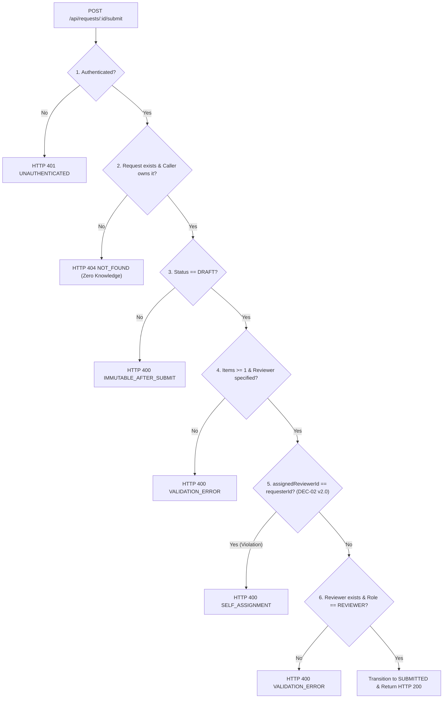

# Part A.2: Impact Analysis & Traceability Table

> **Lab 7: Software Maintenance Metrics and Release Readiness**  
> **Course:** CPE 334 Introduction to Software Engineering (Semester 1/2026, Section 31)  
> **Team:** EN-011 (ExpenseFlow &mdash; Theme 5: Workflow and Approval System)  
> **Traceability Target:** `DEC-02 v2.0` Maintenance Change  

---

## 1. System Impact Analysis Matrix

The table below exhaustively traces the maintenance change from high-level requirement down to implementation code, acceptance criteria, test specifications, and data boundaries:

| Dimension | Affected / In Scope | Unaffected / Preserved | Technical Rationale & Evidence |
|---|---|---|---|
| **Requirement ID** | `FR-03` (Submit expense request) | `FR-01`, `FR-02`, `FR-04`, `FR-05` | Only the submission validation rule changes. Account management, claim creation, and reviewer queues retain their original contract. |
| **Business Rule** | `DEC-02` (Self-assignment policy) | `BR-01` (Self-approval forbidden), `BR-02`, `BR-03`, `BR-04`, `BR-05`, `BR-06` | `DEC-02` transitions from deferred rejection to submission-time rejection. `BR-01` remains active as a 2nd-layer defense-in-depth guard. |
| **Specifications (SRS)** | `docs/srs.md` §3 (`DEC-02`), §4 (`FR-03`) | `docs/srs.md` All other sections | Updated to state HTTP 400 rejection and omission of self from reviewer selection form. |
| **Feature SDS** | `docs/sprints/sprint-1/F-02-request-crud.md` | `F-01-auth.md`, `F-03-reviewer-dashboard.md`, `F-04-approval-guards.md` | `F-02` contract updated in place (§1.1, §2.1, §4, §5) to specify exact guard evaluation sequence. |
| **System-Level SDS** | `docs/system-sds.md` (Submit flow diagram & invariant order) | Architecture & ERD core structure | Sequence diagram updated to reflect immediate HTTP 400 response when requester equals reviewer. |
| **Acceptance Criteria** | `AC-18` (Revised in place), `AC-18e` (Form UI feedback) | `AC-18b` (Empty items check), `AC-18c` (Immutable state), `AC-18d` (Valid reviewer submit) | `AC-18` now expects 400 `SELF_ASSIGNMENT`. `AC-18d` proves that submitting to another reviewer is unaffected. |
| **STS Test IDs** | `TEST-18` (Updated to expect 400), `TEST-18b` | `TEST-31`, `TEST-38` (`BR-01` 403 paths) | `TEST-18` changed from asserting 200 to asserting 400. `TEST-31` & `TEST-38` seed fixtures via Prisma, proving `BR-01` still holds. |
| **API Endpoints** | `POST /api/requests/:id/submit` | `POST /api/requests/:id/review`, `GET /api/requests/:id` | Submit handler enforces `assignedReviewerId != requesterId`. Review handler remains untouched. |
| **UI Components** | `src/app/requests/new/page.tsx` | All other screens | Form excludes the logged-in user from the reviewer list and renders an informative banner if the user is a reviewer. |
| **Persistence & Schema** | None (Prisma schema unchanged) | `prisma/schema.prisma` | The `assignedReviewerId` and `requesterId` relational fields already exist. No migrations or column alterations required. |
| **Historical Data** | Existing claims preserved | `ExpenseRequest`, `ApprovalHistory` | Any legacy submitted claims remain readable; new submissions strictly enforce the guard. |

---

## 2. Invariant Guard Evaluation Sequence

To eliminate ambiguity and prevent security loopholes or race conditions, `POST /api/requests/:id/submit` evaluates request invariants in a deterministic, fail-fast order (as documented in `F-02-request-crud.md` §1.1):

### 2.1 Justification for Ordering
- **Guard 1 (401) before Guard 2 (404):** Adheres to zero-knowledge security; unauthenticated callers must never learn whether an ID exists.
- **Guard 2 (404) before Guard 3 (400):** Unauthorized viewers receive 404 rather than 403 or 400, preserving privacy.
- **Guard 5 (`SELF_ASSIGNMENT`) before Guard 6 (Role check):** If a requester selects themselves, the system immediately returns the specific business reason (`SELF_ASSIGNMENT`) rather than a confusing generic message.

---

## 3. Preserved Behaviors and Regression Protection

| Preserved Behavior | Risk of Maintenance Change | Regression Protection Mechanism |
|---|---|---|
| **Defense-in-Depth (`BR-01`)** | Blocking self-assignment at submit might accidentally lead to removal of the review boundary guard. | `POST /api/requests/:id/review` retains the HTTP 403 `SELF_APPROVAL` check. Automated tests `TEST-31` and `TEST-38` verify that direct review attempts by owners are rejected with 403. |
| **Normal Submission (`AC-18d`)** | Guard might accidentally block legitimate submissions to other reviewers. | `AC-18d` asserts that Alice submitting to Carol Manager succeeds with HTTP 200, sets status to `SUBMITTED`, and updates `assignedReviewerId`. |
| **Empty Items Guard (`AC-18b`)** | Guard reordering might bypass the minimum 1 line item requirement. | Automated test asserts that empty draft submission fails with HTTP 400 `VALIDATION_ERROR` before reviewer check. |
| **Access Isolation (`BR-05`)** | UI filtering might leak reviewer identities across departments. | API only returns active users with `REVIEWER` role, and reviewer dashboard displays only assigned claims. |
